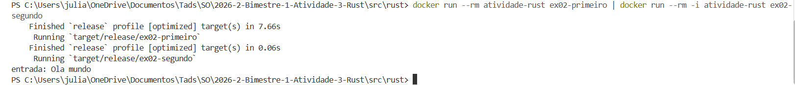
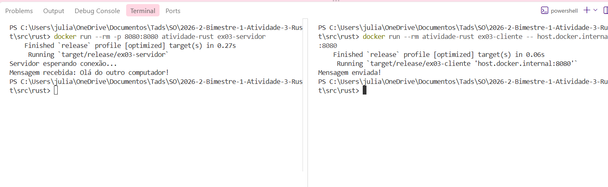

# Relatório sobre implementação de comunicação entre tarefas em Rust

## Introdução

Este relato faz parte do processo avaliativo da disciplina de sistemas operacionas no curso superior em análise e desenvolvimento de sistemas, ofertado na Diretoria acadêmica de gestão e tecnologia da informação no campus natal-central do instituto federal de educação, ciência e tecnologia do rio grande do norte.

Tem como objetivo principal relatar as implementações de comunicação entre tarefas na linguagem Rust.

O grupo de trabalho foi formado por Julia Rafaelly Siqueira de Lima, Lídia Rebeka da Silva Fernandes e Lyonara da Silva Carmêlo.

## Comunicação entre tarefas em Rust

### Informações gerais

#### OBJETIVO DA COMUNICAÇÃO ENTRE TAREFAS:
Permitir que partes de um programa trabalhem juntas
<br>
> * Troca de dados; <br>
> * Coordenação da execução; <br>
> * Não concorrente.
<br>

Em Rust, essa troca acontece de maneira segura, sem as duas threads acessarem a mesma variável ao mesmo tempo de forma direta.

#### SOBRE O DOCKER:
O uso do docker se dá por praticidade, visto que não é necessária a instalação da linguagem Rust em diferentes máquinas. A configuração docker usada foi:
<br>
```dockerfile
FROM rust:1.85
WORKDIR /app
COPY Cargo.toml ./
COPY lib.rs ./lib.rs
COPY bin ./bin
RUN cargo build --release
ENTRYPOINT ["cargo", "run", "--release", "--bin"]
```
<br>

### Comunicação entre tarefas com linhas de execução no mesmo processo

#### CÓDIGO
O código cria duas threads capazes de se comunicar por meio de um __canal (channel)__, uma thread é responsável por __enviar__ a mensagem e a outra por __receber__
<br>

```rust
use std::sync::mpsc;
use std::thread;

fn main() {
    // Cria um canal
    let (tx, rx) = mpsc::channel(); //tx -> transmissor rx -> receptor

    // Cria uma nova thread
    thread::spawn(move || { //manda o valor de tx
        let mensagem = "Olá da outra thread!";

        // Envia a mensagem
        tx.send(mensagem).unwrap(); //envia a mensagem pelo canal
        //unwrap -> encerra o programa com erro caso o envio falhe
    });

    // Recebe a mensagem
    let mensagem_recebida = rx.recv().unwrap();
    //recv -> espera a mensagem chegar

    println!("Mensagem recebida: {}", mensagem_recebida);
}
```
> Disponível em: 2026-2-Bimestre-1-Atividade-3-Rust -> src -> rust -> bin -> "ex01.rs"

#### EXECUÇÃO
O primeiro passo sempre é adicionar o arquivo às configurações do Cargo.toml
Os comandos abaixo devem ser executados na pasta `src/rust`.

__Comandos:__
>docker build -t atividade-rust .

Ele cria/recria a imagem do programa

>docker run --rm atividade-rust ex01

Ele executa o código presente na imagem

__Saída:__
> Mensagem recebida: Olá da outra thread!


##### PROBLEMAS
__1. Docker fechado:__
Durante a execução do código o docker precisa estar aberto

### Comunicação entre tarefas em processos diferentes no mesmo computador

#### CÓDIGO
Dividido em dois programas, onde o primeiro envia uma mensagem para o segundo

__Primeiro programa:__ Enviar mensagem pelo pipe
```rust
fn main() {
    println!("Olá mundo");
}
```
> Disponível em: 2026-2-Bimestre-1-Atividade-3-Rust -> src -> rust -> bin -> "ex02_primeiro.rs"

__Segundo programa:__ Receber mensagem do pipe
```rust
use std::io::{self, BufRead};

fn main() {
    let stdin = io::stdin();
    let mut mensagem = String::new();

    // Lê uma linha enviada pelo primeiro processo pelo pipe.
    stdin
        .lock()
        .read_line(&mut mensagem)
        .expect("não foi possível receber a mensagem pelo pipe");

    println!("entrada: {}", mensagem.trim_end());
}
```
> Disponível em: 2026-2-Bimestre-1-Atividade-3-Rust -> src -> rust -> bin -> "ex02_segundo.rs"

#### EXECUÇÃO
O primeiro passo sempre é adicionar os arquivos às configurações do `Cargo.toml`.
Os comandos abaixo devem ser executados na pasta `src/rust`.

__Comandos:__
>docker build -t atividade-rust .

Ele cria/recria a imagem do programa

>docker run --rm atividade-rust ex02-primeiro | docker run --rm -i atividade-rust ex02-segundo

O pipe (`|`) conecta a saída do primeiro processo à entrada do segundo. A opção `-i` mantém a entrada padrão do segundo container conectada.

__Saída:__



#### PROBLEMAS
__1. Entrada padrão do container receptor:__

O segundo container precisa receber a saída do primeiro pela entrada padrão. A opção `-i` no comando `docker run` mantém essa entrada conectada para que o programa consiga ler a mensagem do pipe. O consumidor lê apenas a primeira linha, assim como `input()` no exemplo Python.

### Comunicação entre tarefas em processos diferentes em computadores diferentes

#### CÓDIGO


__Servidor (socket TCP):__
```rust
use std::io::{BufRead, BufReader};
use std::net::TcpListener; // importa o socket TCP que aguarda conexões

fn main() {
    // Abre a porta 8080
    let servidor = TcpListener::bind("0.0.0.0:8080").unwrap(); // abre uma porta para conexões recebidas

    println!("Servidor esperando conexão...");

    // Espera um computador se conectar
    let (conexao, _) = servidor.accept().unwrap(); // espera o cliente conectar
    let mut leitor = BufReader::new(conexao);

    let mut mensagem = String::new(); // cria uma string para guardar os dados recebidos

    // Recebe a mensagem
    leitor.read_line(&mut mensagem).unwrap();

    println!("Mensagem recebida: {}", mensagem.trim_end());
}
```
> Disponível em: 2026-2-Bimestre-1-Atividade-3-Rust -> src -> rust -> bin -> "ex03_servidor.rs"

__Cliente (socket TCP):__
```rust
use std::io::Write;
use std::net::TcpStream;

fn main() {
    // Usa o endereço informado; por padrão, conecta ao servidor local.
    let endereco = std::env::args()
        .nth(1)
        .unwrap_or_else(|| "127.0.0.1:8080".to_string());
    let mut conexao = TcpStream::connect(&endereco)
        .unwrap_or_else(|erro| panic!("não foi possível conectar a {endereco}: {erro}"));

    let mensagem = "Olá do outro computador!\n";

    // Envia a mensagem
    conexao.write_all(mensagem.as_bytes()).unwrap();
    // Converte o texto em bytes e os envia pelo socket TCP.

    println!("Mensagem enviada!");
}
```
> Disponível em: 2026-2-Bimestre-1-Atividade-3-Rust -> src -> rust -> bin -> "ex03_cliente.rs"

Por padrão, o cliente usa `127.0.0.1:8080`, o endereço de loopback que aponta para o próprio computador. Para executar em containers separados no mesmo computador, o cliente deve receber `host.docker.internal:8080`. Para executar em computadores diferentes, deve receber o IP do computador servidor.

#### EXECUÇÃO
Os comandos abaixo devem ser executados na pasta `src/rust`. A imagem `atividade-rust` precisa estar disponível nos computadores que executarão os programas.
__Comandos:__
>docker build -t atividade-rust .

Ele cria/recria a imagem do programa

>docker run --rm -p 8080:8080 atividade-rust ex03-servidor

Esse comando inicia o servidor. Deixe-o em execução em um terminal.

>docker run --rm atividade-rust ex03-cliente -- host.docker.internal:8080

Esse comando executa o cliente em um container no mesmo computador do servidor. Para informar o IP do servidor quando ele estiver em outro computador, use:

>docker run --rm atividade-rust ex03-cliente -- 192.168.0.10:8080

Substitua `192.168.0.10` pelo IP do computador servidor. Execute o cliente em outro terminal ou computador.

__Saídas:__

__1.Servidor:__

>Servidor esperando conexão...

>Mensagem recebida: Olá do outro computador!

__2.Cliente:__

>Mensagem enviada!



#### PROBLEMAS
__1. Resposta nunca enviada__

O código antigo usava:

```rust
read_to_string
```

Ou seja, o servidor só terminava a leitura quando a conexão era encerrada. Durante o teste, o cliente mandava a mensagem, mas o servidor continuava esperando antes de exibi-la.

<br>

A solução foi substituir essa parte do código por:

```rust
read_line
```
Que conclui a leitura assim que encontra uma quebra de linha. O cliente envia essa quebra junto com a mensagem, tornando a comunicação funcional.

## Considerações finais

#### CONCLUSÃO
Conseguimos implementar e executar tudo com sucesso, adquirindo ensinamentos principalmente pelo uso de docker e da funcionalidade do código em rust.

<br>

Obs: Vídeos das execuções --> [Vídeos](https://www.youtube.com/watch?v=AXVFdxmfjFw&list=PLLiwkXM5Re5I&index=1)
