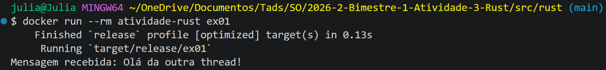

# Relatório sobre implementação de comunicação entre tarefas em Rust

## Introdução

Este relato faz parte do processo avaliativo da disciplina de sistemas operacionas no curso superior em análise e desenvolvimento de sistemas, ofertado na Diretoria acadêmica de gestão e tecnologia da informação no campus natal-central do instituto federal de educação, ciência e tecnologia do rio grande do norte.

Tem como objetivo principal relatar as implementações de comunicação entre tarefas na linguagem Rust.

O grupo de trabalho foi formado por Julia Rafaelly Siqueira de Lima, Lídia Rebeka da Silva Fernandes e Lyonara da Silva Carmêlo.

## Comunicação entre tarefas em Rust

### Informações gerais

#### OBJETIVO DA COMUNICAÇÃO ENTRE TAREFAS:
Permitir que partes de um programa trabalhem juntas
<br>
> * Troca de dados; <br>
> * Coordenação da execução; <br>
> * Não concorrente.
<br>

Em Rust, essa troca acontece de maneira segura, sem as duas threads acessarem a mesma variável ao mesmo tempo de forma direta.

#### SOBRE O DOCKER:
O uso do docker se dá por praticidade, visto que não é necessária a instalação da linguagem Rust em diferentes máquinas. A configuração docker usada foi:
<br>
```dockerfile
FROM rust:1.85
WORKDIR /app
COPY Cargo.toml ./
COPY lib.rs ./lib.rs
COPY bin ./bin
RUN cargo build --release
ENTRYPOINT ["cargo", "run", "--release", "--bin"]
```
<br>

### Comunicação entre tarefas com linhas de execução no mesmo processo

#### CÓDIGO
O código cria duas threads capazes de se comunicar por meio de um __canal (channel)__, uma thread é responsável por __enviar__ a mensagem e a outra por __receber__
<br>

```rust
use std::sync::mpsc;
use std::thread;

fn main() {
    // Cria um canal
    let (tx, rx) = mpsc::channel(); //tx -> transmissor rx -> receptor

    // Cria uma nova thread
    thread::spawn(move || { //manda o valor de tx
        let mensagem = "Olá da outra thread!";

        // Envia a mensagem
        tx.send(mensagem).unwrap(); //envia a mensagem pelo canal
        //unwrap -> encerra o programa com erro caso o envio falhe
    });

    // Recebe a mensagem
    let mensagem_recebida = rx.recv().unwrap();
    //recv -> espera a mensagem chegar

    println!("Mensagem recebida: {}", mensagem_recebida);
}
```
> Disponível em: 2026-2-Bimestre-1-Atividade-3-Rust -> src -> rust -> bin -> "ex01.rs"

#### EXECUÇÃO
O primeiro passo sempre é adicionar o arquivo às configurações do Cargo.toml
Os comandos abaixo devem ser executados na pasta `src/rust`.

__Comandos:__
>docker build -t atividade-rust .

Ele cria/recria a imagem do programa

>docker run --rm atividade-rust ex01

Ele executa o código presente na imagem

__Saída:__
> Mensagem recebida: Olá da outra thread!



##### PROBLEMAS
__1. Docker fechado:__
Durante a execução do código o docker precisa estar aberto

### Comunicação entre tarefas em processos diferentes no mesmo computador

#### CÓDIGO
Dividido em dois programas, onde o primeiro envia uma mensagem para o segundo

__Primeiro programa:__ Enviar mensagem pelo pipe
```rust
fn main() {
    println!("Olá do outro processo!");
}
```
> Disponível em: 2026-2-Bimestre-1-Atividade-3-Rust -> src -> rust -> bin -> "ex02_primeiro.rs"

__Segundo programa:__ Receber mensagem do pipe
```rust
use std::io::{self, BufRead};

fn main() {
    let stdin = io::stdin();
    let mut mensagem = String::new();

    // Lê uma linha enviada pelo primeiro processo pelo pipe.
    stdin
        .lock()
        .read_line(&mut mensagem)
        .expect("não foi possível receber a mensagem pelo pipe");

    println!("entrada: {}", mensagem.trim_end());
}
```
> Disponível em: 2026-2-Bimestre-1-Atividade-3-Rust -> src -> rust -> bin -> "ex02_segundo.rs"

#### EXECUÇÃO
O primeiro passo sempre é adicionar os arquivos às configurações do `Cargo.toml`.
Os comandos abaixo devem ser executados na pasta `src/rust`.

__Comandos:__
>docker build -t atividade-rust .

Ele cria/recria a imagem do programa

>docker run --rm atividade-rust ex02-primeiro | docker run --rm -i atividade-rust ex02-segundo

O pipe (`|`) conecta a saída do primeiro processo à entrada do segundo. A opção `-i` mantém a entrada padrão do segundo container conectada.

__Saída:__

```text
entrada: Olá do outro processo!
```

#### PROBLEMAS
__1. Entrada padrão do container receptor:__

O segundo container precisa receber a saída do primeiro pela entrada padrão. A opção `-i` no comando `docker run` mantém essa entrada conectada para que o programa consiga ler a mensagem do pipe. O consumidor lê apenas a primeira linha, assim como `input()` no exemplo Python.

### Comunicação entre tarefas em processos diferentes em computadores diferentes

#### CÓDIGO

O produtor envia uma lista de números por um socket TCP. O consumidor recebe os dados pelo socket e calcula a soma. O Docker Compose inicia os dois programas em containers separados, ligados pela rede interna do Compose.

__Consumidor (servidor TCP):__
```rust
use std::io::{BufRead, BufReader};
use std::net::TcpListener;

fn main() {
    // Cria um socket TCP e escuta conexões na porta 8080.
    let servidor = TcpListener::bind("0.0.0.0:8080").unwrap();

    println!("Servidor esperando conexão...");

    // Aceita a conexão TCP do produtor.
    let (conexao, _) = servidor.accept().unwrap();
    let mut leitor = BufReader::new(conexao);

    let mut mensagem = String::new();

    // Recebe os dados enviados pelo produtor.
    leitor.read_line(&mut mensagem).unwrap();

    let dados: Vec<u32> = mensagem
        .trim()
        .split(',')
        .map(|valor| valor.parse().expect("dado recebido não é um número válido"))
        .collect();
    let soma: u32 = dados.iter().sum();

    println!("Dados recebidos: {dados:?}");
    println!("Soma calculada: {soma}");
}
```
> Disponível em: 2026-2-Bimestre-1-Atividade-3-Rust -> src -> rust -> bin -> "ex03_servidor.rs"

__Produtor (cliente TCP):__
```rust
use std::io::Write;
use std::net::TcpStream;
use std::thread;
use std::time::Duration;

fn main() {
    // No Docker Compose, o nome do serviço consumidor funciona como endereço.
    let endereco = std::env::args()
        .nth(1)
        .unwrap_or_else(|| "127.0.0.1:8080".to_string());

    // Aguarda o consumidor ficar pronto antes de abandonar a conexão.
    let mut tentativas = 0;
    let mut conexao = loop {
        match TcpStream::connect(&endereco) {
            Ok(conexao) => break conexao,
            Err(_) if tentativas < 20 => {
                tentativas += 1;
                thread::sleep(Duration::from_millis(250));
            }
            Err(erro) => panic!("não foi possível conectar a {endereco}: {erro}"),
        }
    };

    let dados = [10, 20, 30];
    let mensagem = dados
        .iter()
        .map(|valor| valor.to_string())
        .collect::<Vec<_>>()
        .join(",");

    // Envia os dados pelo socket TCP, terminando a mensagem com uma quebra de linha.
    conexao
        .write_all(format!("{mensagem}\n").as_bytes())
        .expect("não foi possível enviar os dados");

    println!("Dados enviados: {mensagem}");
}
```
> Disponível em: 2026-2-Bimestre-1-Atividade-3-Rust -> src -> rust -> bin -> "ex03_cliente.rs"

O Compose cria uma rede para os containers, e o produtor encontra o consumidor pelo nome do serviço `consumidor`. Esse teste usa dois containers no mesmo computador. Para executar em computadores diferentes, informe ao produtor o IP do computador onde o consumidor está rodando.

__Configuração do Docker Compose (`compose.yaml`):__

```yaml
services:
  consumidor:
    image: atividade-rust
    build: .
    command: ["ex03-servidor"]

  produtor:
    image: atividade-rust
    command: ["ex03-cliente", "--", "consumidor:8080"]
    depends_on:
      - consumidor
```

#### EXECUÇÃO
Os comandos abaixo devem ser executados na pasta `src/rust`.
__Comandos:__

```powershell
docker compose up --build
```

Esse comando constrói a imagem e inicia o consumidor e o produtor. O Compose inicia primeiro o consumidor; o produtor tenta se conectar até que o socket esteja pronto.

Configuração em `compose.yaml`:

```yaml
services:
  consumidor:
    image: atividade-rust
    build: .
    command: ["ex03-servidor"]

  produtor:
    image: atividade-rust
    command: ["ex03-cliente", "--", "consumidor:8080"]
    depends_on:
      - consumidor
```

Para encerrar e remover os containers e a rede criada pelo Compose, use:

```powershell
docker compose down
```

__Saídas:__

__Consumidor:__

>Servidor esperando conexão...

>Dados recebidos: [10, 20, 30]

>Soma calculada: 60

__Produtor:__

>Dados enviados: 10,20,30

#### PROBLEMAS
__1. Inicialização dos containers:__

O produtor pode iniciar antes de o consumidor estar pronto para aceitar conexões. Para resolver esse problema, o produtor tenta se conectar novamente por alguns segundos antes de exibir um erro.

## Considerações finais

#### CONCLUSÃO
Conseguimos implementar e executar tudo com sucesso, adquirindo ensinamentos principalmente pelo uso de docker e da funcionalidade do código em rust.

<br>

Obs: Vídeos das execuções --> [Vídeos](https://www.youtube.com/watch?v=AXVFdxmfjFw&list=PLLiwkXM5Re5I&index=1)
